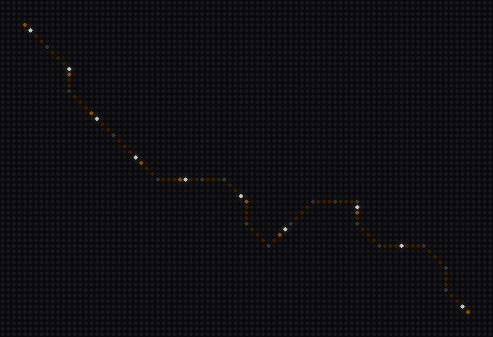

# ldn-tube-leds — step 1: the Bakerloo line

[](https://github.com/JT-39/ldn-tube-leds/actions/workflows/tests.yml)
[](https://jt-39.github.io/ldn-tube-leds/)

Live Bakerloo line trains on an LED matrix. For now the matrix is an emulator in
your browser. The emulator uses the same API as the real Raspberry Pi library,
so this code will drive real panels later without changes.

**Website: <https://jt-39.github.io/ldn-tube-leds/>.** The same Python model runs
in the browser via Pyodide (see [Website](#website) below).



*(The animation uses the simulated demo feed, not live data.)*

## Quick start

```bash
git clone https://github.com/JT-39/ldn-tube-leds.git
cd ldn-tube-leds
uv sync
uv run tube-leds run --demo --speed 10   # simulated trains, 10x speed → opens http://localhost:8888
uv run tube-leds route                   # fetch the real station list from TfL + ASCII preview
uv run tube-leds peek                    # table of where every live train is right now
uv run tube-leds check                   # how often we agree with TfL's own location text
uv run tube-leds run                     # the real thing
uv run pytest                            # 42 tests
```

Run commands from the project folder: data lives in `./data`.

**API key (optional, free):** register at <https://api-portal.tfl.gov.uk>, then
`export TFL_APP_KEY=...`. Without a key you're rate limited more tightly, which
is fine at one request every 30 s.

## How it works

```
TfL arrivals ──► positions.py ──► layout.py ──► app.py ──► LED matrix
 (every 30 s)    where is each    which pixel    draw a frame   (emulator now,
                 train right now? is that?       20x a second    real panels later)
```

| Module | The idea |
|---|---|
| `tfl.py` | Two kinds of data. The **route** (stations in order, with coordinates) is static, so it's fetched once and cached as JSON. **Arrivals** are live: one row per train *per upcoming station*, e.g. "train 236 reaches Paddington in 95 s". |
| `positions.py` | Trains have no GPS, so position is **inferred**. Group rows by `vehicleId`, take the soonest station as "next stop", work out direction, then `progress = 1 − seconds_to_next / run_time`. Between polls, **dead reckoning** keeps trains moving smoothly. |
| `layout.py` | Stations → pixels. A geographic layout fails in central London (Charing Cross and Embankment are ~170 m apart), so the default is a **schematic**: directions snapped to 45°, equal spacing, like Harry Beck's map. Each direction gets its own track, and trains keep left. |
| `app.py` | Draws frames, runs the loop, CLI. `make_matrix()` tries the real `rgbmatrix` library first and falls back to the emulator. |
| `demo.py` | A fake TfL feed with the same JSON shape, for offline work and tests. It's simulated, so don't analyse it. |

Two bits that are fun from a data science angle:

- **`run_time` is a model with two parameters.** It's an overhead plus distance ÷ speed (`30 s + metres / 15`). Those numbers are guesses, waiting to be fitted.
- **Direction labels are learned.** TfL tags trains "inbound"/"outbound", but what that means varies by line. `estimate_positions` takes a majority vote from trains whose direction is obvious (from their destination), then applies the label to ambiguous ones.

## Things to try

1. **Sanity-check the model.** `uv run tube-leds peek` shows our estimate next to TfL's own `currentLocation` text ("Between Paddington and Edgware Road"). Where do they disagree, and why?
2. **See why tube maps are schematic.** `uv run tube-leds route --layout geo --size 64x32 --tracks 1` reports a collision. Then compare `uv run tube-leds run --layout geo`.
3. **Fit the run-time model.** Collect real data with `uv run tube-leds record --minutes 120`. Load `data/snapshots/*.jsonl` into polars or pandas and explode the `arrivals` lists. For each train, find when its "next stop" changes: that's a departure. Measure station-to-station times, regress them on distance, and plug the fitted overhead and speed into `default_run_time`.
4. **Try another unbranched line.** `uv run tube-leds route --line victoria`, then `run --line victoria`. Jubilee and Waterloo & City work too. Branched lines (Northern, District…) need step 2.
5. **Make it look like the real thing.** `run --no-track` lights only the trains, as on Fraser's map, where the printed map provides the lines.
6. **One track or two.** By default each direction has its own track and trains keep left, so direction is obvious at a glance. `--tracks 1` puts both directions on one line. `layout.left_offsets` is the geometry: a bit of vector maths (normals and miters) worth reading.

## Is the map right?

Almost every source of Tube times (platform boards, TfL Go, Apple Maps, other live
maps) is fed by the same TfL predictions we use. So comparing with them tests
*our reading* of the data. Only the real world tests TfL itself. That gives three levels:

**1. Do we read TfL's data correctly?** (automatic)
TfL attaches its own free-text location to every train ("Between Paddington and
Edgware Road"). We never use it to place trains, so it makes a good independent check.
`validate.py` pulls out the station names and checks they match our estimated segment.

```bash
uv run tube-leds check                     # right now: agreement rate + each disagreement
uv run tube-leds record --minutes 120      # collect data...
uv run tube-leds check --snapshots data/snapshots/*.jsonl   # ...then score it, and see where we go wrong
```

The website shows the same thing: an agreement rate above the train list, and ✓/≠
next to TfL's text for each train. On simulated data it's 100% by design, which only
proves the plumbing works.

**2. Do our times match other apps?**
Tap a station on the website to see its next trains, grouped like a platform board.
Open the same station in TfL Go or Apple Maps (departures) and compare: they should
agree to within about a minute. Apps refresh at different moments, and we
dead-reckon between our 30-second updates. For positions, compare the map
side by side with londonunderground.live.

**3. Is it true?** (the only fully independent test)
Stand on a platform with the station board open. Note when it says "due" and when the
train actually arrives. Or ride a train: find your dot by its next stop and
direction, and note when it reaches each station compared with when you do. A dozen
observations make a small dataset of errors to analyse. That's also how you'd fit
the run-time model properly (see "Things to try").

## Website

The site is static: GitHub Pages serves a few files and your browser does all the work.

```
web/index.html ─┐                      ┌─ fetch TfL arrivals (JS, every 30 s)
src/tube_leds/  ├─ scripts/build_site.py ─► _site/ ─► browser ─┤
data/routes/   ─┘                      └─ Pyodide runs tube_leds.web.Board → canvas
```

- `src/tube_leds/web.py` is the bridge: a `Board` the page feeds TfL JSON into and reads lit pixels out of. It reuses `positions`, `layout` and `draw_frame` unchanged. That's why `tfl.py` only imports `httpx` when it actually makes a request.
- **Station labels** are placed by a small map-labelling optimiser in `web/index.html`. For each station it lists candidate spots (beside it, round the corner, at 45° like a dense tube map) and rejects any that touch the track or would sit closer to another station. Then it places labels greedily, ends and interchanges first (TfL's route data says how many lines stop at each station), with 40 seeded random restarts to keep the best layout. Unlabelled stations show their name when tapped.
- TfL's API allows browser requests (CORS), so no server is needed. If TfL can't be reached, the page says so and shows simulated trains.
- Preview locally: `uv run python scripts/build_site.py && python -m http.server -d _site 8000`, then open <http://localhost:8000>.
- Every push to `main` runs the tests, then builds and publishes the site (`.github/workflows/pages.yml`).

## Roadmap

- **Step 2:** all lines, with branches. A route becomes a *graph*, not a list.
- **Step 3:** a hand-drawn pixel map. Trace each line over a scan of the Tube map in a small pixel editor and export a `Layout`. This is the "by hand, every pixel" part.
- **Step 4:** better positions. Fitted run times, smoothing noisy predictions, remembering trains between polls.
- **Step 5:** hardware. A Raspberry Pi, an Adafruit RGB Matrix Bonnet, HUB75 panels and a beefy 5 V supply. Install `rpi-rgb-led-matrix` and `make_matrix()` switches over automatically.
- **Step 6:** print the map to match the pixel grid, add a diffuser, and build the frame.

## Caveat

This was built and tested offline: the layout, model and emulator are all tested
against the bundled station list and the demo feed. The live calls follow TfL's
documented response format but haven't yet been run against the real API. If
`route` or `peek` throws an error, that's the first thing to look at.
